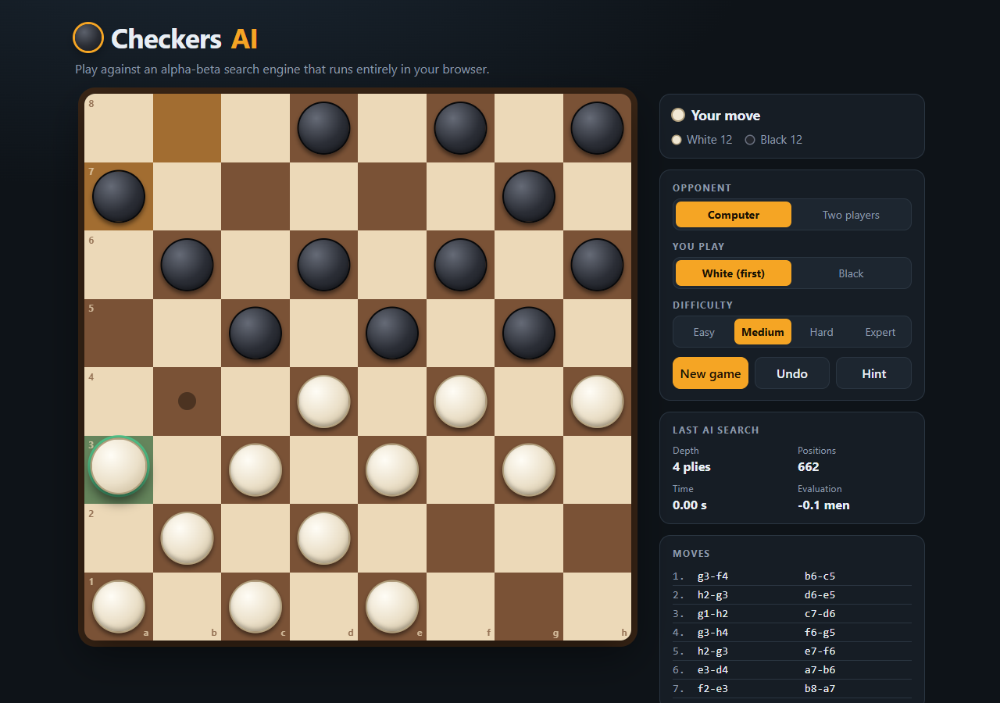
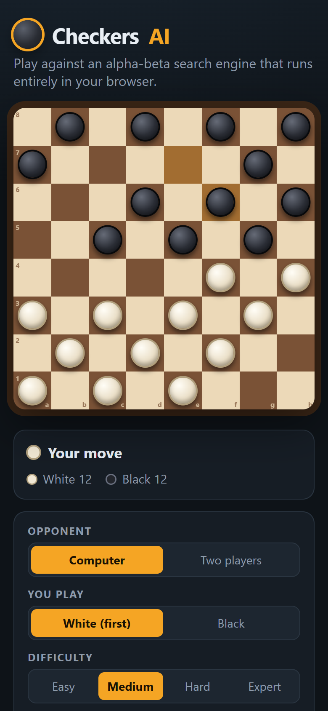
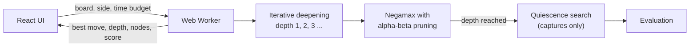

<div align="center">

# Checkers AI

**Play checkers against an alpha-beta search engine that runs entirely in your browser.**

[**Play it live →**](LIVE_URL)




</div>

---

## About

This started as a C console program (a lab project): an 8×8 checkers game for two players or one player against a minimax bot. This repository turns it into a proper web app.

- The **game engine and AI were ported from C to TypeScript** and run in a Web Worker, so the page stays smooth while the AI thinks. There is no server and no API; the whole thing is a static site.
- The **AI was upgraded** along the way: it now searches deeper than the original's fixed 4 plies, typically 8 to 10 plies at the *Hard* setting, and it evaluates positions instead of just counting pieces. (See [How the AI works](#how-the-ai-works).)
- The **original C program is still here** in [`cli/`](cli) and still builds and runs.

## Features

- Play against the computer at four difficulty levels, or against a friend on the same screen
- Choose to play White (moves first) or Black
- Click a piece to see its legal moves. Captures are marked with a red ring
- **Hint** button that shows the AI's best move for you
- **Undo** that takes back a full round
- Last-move highlighting, animated pieces, move list in a1–h8 notation and live piece counts
- A look inside the AI: depth reached, positions searched, time and evaluation of its last search
- Responsive layout that works on phones, with light and dark themes that follow your system
- Keyboard accessible: every square is a button with a descriptive label

<div align="center">

</div>

## How the AI works

The AI is a classic game-tree search, written in [`src/engine/ai.ts`](src/engine/ai.ts).



| Technique | What it does |
| --- | --- |
| **Minimax / negamax** | Looks ahead through every legal move and reply, assuming both sides play their best. |
| **Alpha-beta pruning** | Skips branches that cannot change the result. It returns the same move as plain minimax while searching a small fraction of the positions. |
| **Iterative deepening** | Searches 1 move ahead, then 2, then 3 and so on until the time budget runs out, then plays the best move of the last depth that finished. Each pass also tells the next one which move to try first. |
| **Move ordering** | Captures are tried first, which makes alpha-beta prune far more. |
| **Quiescence search** | At the end of the search it keeps playing out captures, so it never mistakes a piece that is about to be taken for a safe one. |
| **Win and loss scoring** | A side with no legal move has lost. Sooner wins score higher and sooner losses score lower, so the AI finishes games rather than shuffling. |

**Evaluation.** A position is scored in hundredths of a man: a man is worth 100 and a king 250, plus small bonuses for how far a man has advanced, for keeping men on the home row to block promotion, and for holding the centre of the board.

**Difficulty levels** change the time and depth the AI is allowed:

| Level | Time per move | Max depth |
| --- | --- | --- |
| Easy | 0.15 s | 2 plies |
| Medium | 0.5 s | 4 plies |
| Hard | 1.2 s | unlimited |
| Expert | 3 s | unlimited |

### How it compares with the original C bot

The original bot searched a fixed 4 plies and only counted pieces. The upgraded engine was played against it from random openings, each side taking both colours:

| Time per move | Upgraded wins | Original wins | Draws |
| --- | --- | --- | --- |
| 60 ms | 38 | 0 | 2 |
| 300 ms | 15 | 0 | 1 |

### Verifying the TypeScript port

The TypeScript engine was checked against the C engine on 301 positions (the starting position plus random ones with 1 to 12 pieces a side, including kings). For every position the move counts to depth 3, the evaluation and the move chosen at a fixed search depth of 6 were identical. The move generation totals are also pinned in the unit tests.

## Rules in this version

These are the rules the original C program implemented, kept as they were:

- Pieces move diagonally onto empty dark squares. White starts on ranks 1 to 3 and moves first.
- Men move and capture **forward only**. Kings move and capture one square in any direction.
- A capture jumps over an adjacent enemy piece into the empty square behind it.
- **Captures are optional** and a turn is a **single jump** (no chained multi-jumps).
- A man that reaches the far row becomes a king.
- You win when your opponent has no pieces or no legal move.

Mandatory captures and multi-jumps are common in other rule sets; see [ideas for next steps](#ideas-for-next-steps).

## Getting started

You need [Node.js](https://nodejs.org) 20 or newer.

```bash
git clone REPO_URL
cd ai-checkers
npm install
npm run dev        # http://localhost:5173
```

| Command | What it does |
| --- | --- |
| `npm run dev` | Start the dev server with hot reload |
| `npm run build` | Typecheck and build the site into `dist/` |
| `npm run preview` | Serve the production build locally |
| `npm test` | Run the unit tests |
| `npm run typecheck` | Run the TypeScript compiler without emitting files |

## The original C program

The console version lives in [`cli/checkersprojectPFLAB2023.c`](cli/checkersprojectPFLAB2023.c). It has the same rules and the same AI as the web app, and plays in the terminal.

```bash
gcc -O2 -o checkers cli/checkersprojectPFLAB2023.c
./checkers
```

Enter moves as `row column`, one pair per line, for the piece to move and then for the square to move it to. The AI thinks for up to a second per move; change `AI_TIME_MS` at the top of the file to trade speed for strength.

## Project structure

```
.
├── src
│   ├── engine
│   │   ├── rules.ts        Board, move generation, applying and undoing moves
│   │   ├── ai.ts           Evaluation and the search
│   │   ├── ai.worker.ts    Runs the search off the main thread
│   │   ├── game.ts         Game state, move history, difficulty levels
│   │   └── engine.test.ts  Unit tests
│   ├── hooks/useAi.ts      Talks to the worker from React
│   ├── components
│   │   ├── Board.tsx       The board and the pieces
│   │   └── Panel.tsx       Status, settings, AI stats and move list
│   ├── App.tsx             Game flow: turns, undo, hints
│   └── styles.css
├── cli                     The original C console program
├── docs                    Screenshots used in this README
└── index.html
```

## Deploying

The app builds to a plain static site, so it works on any static host. On [Vercel](https://vercel.com):

1. Import the repository. Vercel detects Vite automatically.
2. Keep the defaults: build command `npm run build`, output directory `dist`.
3. Deploy.

## Ideas for next steps

- Optional rule sets: mandatory captures, multi-jump chains and flying kings
- A transposition table and an opening book for a stronger AI
- Saving the game in the browser and sharing a position by link
- Installable offline PWA

## Credits

Built as a lab project in C, then rebuilt for the web with React, TypeScript and Vite.
